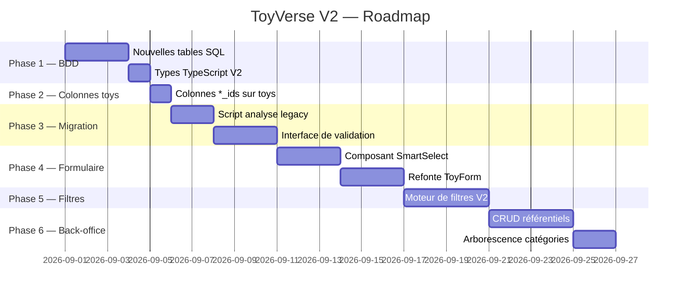

# Plan d'implémentation — ToyVerse V2
## Refonte de « Catégorie » et « Studio/Licence/Lieux » (migration progressive et rétrocompatible)

Basé sur le [Cahier des charges V2](file:///c:/ANTOINE/GITHUB/toy-verse/_Perso/Cahier_des_charges_ToyVerse_V2_formulaire.md).

**Stack actuelle :** Next.js 14 (App Router) · Supabase (PostgreSQL) · TypeScript · Tailwind CSS

---

## Contexte de l'existant

La table `toys` contient aujourd'hui deux champs plats :
- `categorie` (string | null) — ex: `"Figurine"`
- `studio` (string) — ex: `"Disney / Pixar / Toy Story"`

Il existe également une table `categories` rudimentaire avec uniquement un champ `name`. Il n'y a aucune entité pour Studio, Licence, Franchise, Personnage ou Lieu.

Le formulaire ([ToyForm.tsx](file:///c:/ANTOINE/GITHUB/toy-verse/components/toys/ToyForm.tsx)) utilise de simples `<input type="text">`. Les filtres ([FilterContent.tsx](file:///c:/ANTOINE/GITHUB/toy-verse/components/filters/FilterContent.tsx)) filtrent sur les valeurs textuelles brutes.

---

## Principe directeur

> **Règle n°1 : aucune rupture.** Les champs `categorie` et `studio` ne sont jamais supprimés. Les deux systèmes coexistent pendant toute la migration.

---

## Phases d'implémentation



---

## Phase 1 — Nouvelles tables SQL (BDD)

> Créer toutes les nouvelles entités sans toucher aux tables existantes.

### Nouvelles tables à créer dans Supabase

```sql
-- Catégories hiérarchiques (remplace la table `categories` plate)
CREATE TABLE categories_v2 (
  id          TEXT PRIMARY KEY,   -- ex: "cat_001"
  name        TEXT NOT NULL,
  slug        TEXT NOT NULL UNIQUE,
  parent_id   TEXT REFERENCES categories_v2(id),
  level       INT DEFAULT 0,
  description TEXT,
  icon        TEXT,
  active      BOOLEAN DEFAULT true,
  sort_order  INT DEFAULT 0,
  aliases     TEXT[] DEFAULT '{}',
  created_at  TIMESTAMPTZ DEFAULT NOW()
);

-- Studios (avec hiérarchie, ex: Pixar → Disney)
CREATE TABLE studios (
  id               TEXT PRIMARY KEY,
  name             TEXT NOT NULL,
  slug             TEXT NOT NULL UNIQUE,
  description      TEXT,
  parent_studio_id TEXT REFERENCES studios(id),
  country          TEXT,
  active           BOOLEAN DEFAULT true,
  aliases          TEXT[] DEFAULT '{}',
  created_at       TIMESTAMPTZ DEFAULT NOW()
);

-- Licences (ex: Toy Story, Star Wars)
CREATE TABLE licenses (
  id                TEXT PRIMARY KEY,
  name              TEXT NOT NULL,
  slug              TEXT NOT NULL UNIQUE,
  description       TEXT,
  parent_license_id TEXT REFERENCES licenses(id),
  active            BOOLEAN DEFAULT true,
  aliases           TEXT[] DEFAULT '{}',
  created_at        TIMESTAMPTZ DEFAULT NOW()
);

-- Franchises (ex: Toy Story sous Pixar)
CREATE TABLE franchises (
  id                  TEXT PRIMARY KEY,
  name                TEXT NOT NULL,
  slug                TEXT NOT NULL UNIQUE,
  description         TEXT,
  parent_franchise_id TEXT REFERENCES franchises(id),
  active              BOOLEAN DEFAULT true,
  created_at          TIMESTAMPTZ DEFAULT NOW()
);

-- Personnages
CREATE TABLE characters (
  id           TEXT PRIMARY KEY,
  name         TEXT NOT NULL,
  slug         TEXT NOT NULL UNIQUE,
  description  TEXT,
  image_url    TEXT,
  franchise_ids TEXT[] DEFAULT '{}',
  active       BOOLEAN DEFAULT true,
  created_at   TIMESTAMPTZ DEFAULT NOW()
);

-- Lieux d'achat (valeur souvenir)
CREATE TABLE locations (
  id                 TEXT PRIMARY KEY,
  name               TEXT NOT NULL,
  slug               TEXT NOT NULL UNIQUE,
  description        TEXT,
  parent_location_id TEXT REFERENCES locations(id),
  active             BOOLEAN DEFAULT true,
  created_at         TIMESTAMPTZ DEFAULT NOW()
);

-- Tables de liaison N:N (toys ↔ entités)
CREATE TABLE toy_categories   (toy_id TEXT, category_id  TEXT, PRIMARY KEY (toy_id, category_id));
CREATE TABLE toy_studios       (toy_id TEXT, studio_id    TEXT, PRIMARY KEY (toy_id, studio_id));
CREATE TABLE toy_licenses      (toy_id TEXT, license_id   TEXT, PRIMARY KEY (toy_id, license_id));
CREATE TABLE toy_franchises    (toy_id TEXT, franchise_id TEXT, PRIMARY KEY (toy_id, franchise_id));
CREATE TABLE toy_characters    (toy_id TEXT, character_id TEXT, PRIMARY KEY (toy_id, character_id));
CREATE TABLE toy_locations     (toy_id TEXT, location_id  TEXT, PRIMARY KEY (toy_id, location_id));
```

> [!IMPORTANT]
> La table `categories` existante est **conservée** en l'état (non supprimée). `categories_v2` est une nouvelle table parallèle. La migration vers V2 se fait progressivement.

### Fichiers à créer / modifier

#### [MODIFY] [type.ts](file:///c:/ANTOINE/GITHUB/toy-verse/lib/supabase/type.ts)
Ajouter les types Supabase pour toutes les nouvelles tables.

#### [NEW] `lib/supabase/referential.ts`
Fonctions d'accès Supabase pour lire/écrire les référentiels (categories_v2, studios, licenses, franchises, characters, locations).

---

## Phase 2 — Colonnes *_ids sur la table `toys`

> Ajouter les colonnes de liaison directement sur `toys` pour le fallback rapide, EN PLUS des tables de liaison.

```sql
ALTER TABLE toys
  ADD COLUMN IF NOT EXISTS category_ids  TEXT[] DEFAULT '{}',
  ADD COLUMN IF NOT EXISTS studio_ids    TEXT[] DEFAULT '{}',
  ADD COLUMN IF NOT EXISTS license_ids   TEXT[] DEFAULT '{}',
  ADD COLUMN IF NOT EXISTS franchise_ids TEXT[] DEFAULT '{}',
  ADD COLUMN IF NOT EXISTS character_ids TEXT[] DEFAULT '{}',
  ADD COLUMN IF NOT EXISTS location_ids  TEXT[] DEFAULT '{}';
```

> [!NOTE]
> Les colonnes `categorie` (string) et `studio` (string) **restent intactes**. Les deux systèmes coexistent — l'ancien frontend continue de fonctionner sans aucune modification.

### Fichiers à modifier

#### [MODIFY] [type.ts](file:///c:/ANTOINE/GITHUB/toy-verse/lib/supabase/type.ts)
Ajouter les nouveaux champs `*_ids` au type `toys.Row / Insert / Update`.

#### [MODIFY] [theme.ts](file:///c:/ANTOINE/GITHUB/toy-verse/types/theme.ts)
Étendre le type `Toy` avec les champs optionnels `category_ids`, `studio_ids`, etc.

---

## Phase 3 — Migration automatique semi-guidée

> Parser les champs legacy et proposer des correspondances à valider par l'utilisateur. Jamais de migration aveugle irréversible.

### Logique d'analyse

```
categorie = "Figurine"         → categoryIds = ["cat_figurine"]        (certitude : 100%)
studio    = "Disney / Pixar"   → studioIds = ["studio_pixar"]?         (certitude : probable)
studio    = "Bretagne"         → locationIds = ["location_bretagne"]?   (certitude : inconnue → validation)
```

**Trois états de confiance :**
| Confiance | Exemple | Comportement |
|-----------|---------|--------------|
| Certaine (≥90%) | `"Figurine"` → `cat_figurine` | Appliqué automatiquement, signalé |
| Probable (50–89%) | `"Disney Pixar"` → ? | Suggéré, requiert confirmation |
| Inconnue (<50%) | `"Disney/Pixar/Toy Story"` | Valeur legacy conservée, alerte |

### Interface de validation (page admin)

Écran de migration listant les jouets avec valeurs ambiguës :
```
Jouet : Woody
  categorie (legacy) : "Figurine"
  studio (legacy)    : "Disney / Pixar / Toy Story"

  ✓ Catégorie suggérée : Figurine        [Confirmer] [Modifier]
  ? Studio suggéré     : Pixar           [Confirmer] [Modifier] [Aucun]
  ? Licence suggérée   : Disney          [Confirmer] [Modifier] [Aucun]
  ? Franchise suggérée : Toy Story       [Confirmer] [Modifier] [Aucun]
```

### Fichiers à créer

#### [NEW] `scripts/analyze-legacy-data.ts`
Script Node.js qui lit tous les jouets, analyse les champs legacy et produit un rapport JSON avec niveaux de confiance.

#### [NEW] `app/(protected)/admin/migration/page.tsx`
Interface de validation de la migration, ligne par ligne.

#### [NEW] `app/actions/migration.ts`
Server actions pour appliquer/rejeter les suggestions de migration.

---

## Phase 4 — Nouveau formulaire

> Remplacer les `<input type="text">` par des sélecteurs intelligents avec recherche assistée et auto-complétion.

### Composant clé : `SmartSelect`

```
[ Pixar                         × ]
[ Rechercher un studio...         ]
  ↳ Pixar Animation Studios  ✓
  ↳ Pixar (alias)
  ↳ + Créer "Pixar" comme nouveau studio
```

**Comportements :**
- Recherche en temps réel dans le référentiel (debounce 200ms)
- Affiche les aliases dans les suggestions
- Option "Créer une nouvelle entrée" si introuvable
- Sélection multiple (N:N)

### Détection intelligente & suggestions

```
Personnage saisi : Woody
↓ Détection automatique
  Franchise suggérée : Toy Story  ✓ [Appliquer]
  Studio suggéré     : Pixar      ✓ [Appliquer]
```

> [!IMPORTANT]
> Les suggestions ne s'appliquent **jamais silencieusement**. L'utilisateur doit toujours confirmer explicitement.

### Structure du formulaire V2

```
[SIMPLE — visible par défaut]
  Nom *
  Catégorie         ← SmartSelect (niveau 0)
  Univers           ← bouton "+ Ajouter"
  Année de sortie
  Photo

[+ Plus de détails — masqué par défaut]
  Sous-catégorie    ← SmartSelect (niveau 1, dépend de Catégorie)
  Studio            ← SmartSelect
  Licence           ← SmartSelect
  Franchise         ← SmartSelect
  Personnage(s)     ← SmartSelect (multi)
  Lieu d'achat      ← SmartSelect
  Taille / Nb pièces / Numéro / Exposé / Prochainement
```

### Fichiers à créer / modifier

#### [NEW] `components/ui/SmartSelect.tsx`
Composant générique de recherche avec création inline.

#### [NEW] `components/ui/SmartSelectMulti.tsx`
Variante multi-sélection pour les personnages.

#### [NEW] `components/ui/SuggestionBanner.tsx`
Bandeau de suggestion contextuelle (ex: "Franchise Toy Story détectée").

#### [MODIFY] [ToyForm.tsx](file:///c:/ANTOINE/GITHUB/toy-verse/components/toys/ToyForm.tsx)
Refonte complète pour intégrer les SmartSelects et le panneau "Plus de détails".

#### [NEW] `app/api/referential/search/route.ts`
Route API pour la recherche autocomplete dans les référentiels (categories, studios, licenses, franchises, characters, locations).

#### [NEW] `app/api/referential/suggest/route.ts`
Route API qui, à partir d'un personnage ou d'une franchise, suggère les entités associées.

---

## Phase 5 — Moteur de filtres V2

> Remplacer le filtrage par texte brut par un filtrage par IDs avec gestion de la hiérarchie.

### Nouveau comportement

| Avant | Après |
|-------|-------|
| `category = "Figurine"` (string) | `category_ids @> ["cat_001"]` (array PostgreSQL) |
| Pas de hiérarchie | Mode strict / mode étendu (inclure sous-catégories) |
| Filtre OR dans un groupe | Filtre AND inter-dimensions, OR intra-dimension |
| Comptages calculés en JS | Comptages via requête SQL avec `GROUP BY` |

### Logique de hiérarchie

```
Filtre "Figurine" en mode étendu
→ Récupérer tous les enfants de cat_figurine (récursif)
→ WHERE category_ids && ARRAY['cat_001', 'cat_002', 'cat_003', ...]
```

### Filtres facettés dynamiques

Quand l'utilisateur sélectionne un filtre, les comptages des autres facettes se recalculent :
```
Studio : Pixar sélectionné
→ Recalcul côté serveur :
   Catégories    : Figurine (43), Peluche (8), Véhicule (5), Jeu (0 — grisé)
   Franchises    : Toy Story (31), Cars (12)
   Personnages   : Woody (15), Buzz (12)...
```

### Fichiers à créer / modifier

#### [MODIFY] [filters.ts](file:///c:/ANTOINE/GITHUB/toy-verse/types/filters.ts)
Étendre `Filters` et `FilterCounts` avec les nouvelles dimensions (licenses, franchises, characters, locations) et le mode strict/étendu.

#### [NEW] `lib/supabase/toyFilters.ts`
Requêtes Supabase paramétrées pour les filtres V2 (requêtes SQL avec hiérarchie).

#### [MODIFY] [FilterContent.tsx](file:///c:/ANTOINE/GITHUB/toy-verse/components/filters/FilterContent.tsx)
Ajouter les nouveaux filtres (Studio→License→Franchise→Personnage→Lieu), toggle strict/étendu, affichage des valeurs à 0 grisées.

#### [NEW] `components/filters/HierarchyFilter.tsx`
Composant pour afficher un filtre avec arborescence (dépliable par niveau).

---

## Phase 6 — Back-office de gestion des référentiels

> Interface d'administration pour gérer les entités sans modifier directement les jouets.

### Sections du back-office

```
/admin/referential
  ├── /categories     ← Arborescence Catégorie → Sous-catégorie → Type
  ├── /studios        ← Arborescence Studio (Disney → Pixar)
  ├── /licenses       ← Liste avec parentLicenseId
  ├── /franchises     ← Liste avec parentFranchiseId
  ├── /characters     ← Liste avec franchiseIds
  └── /locations      ← Arborescence Lieu d'achat
```

### Fonctionnalités de chaque section

- Affichage en arborescence (drag & drop pour réorganiser)
- CRUD inline (créer, renommer, archiver, fusionner)
- Gestion des aliases (synonymes)
- Visualisation du nombre de jouets liés
- Bouton "Fusionner avec..." pour gérer les doublons

### Fichiers à créer

#### [NEW] `app/(protected)/admin/referential/layout.tsx`
Layout du back-office avec navigation latérale.

#### [NEW] `app/(protected)/admin/referential/[entity]/page.tsx`
Page générique par entité (categories, studios, licenses, franchises, characters, locations).

#### [NEW] `components/admin/ReferentialTree.tsx`
Composant d'arborescence interactive.

#### [NEW] `components/admin/ReferentialEditor.tsx`
Formulaire d'édition inline d'une entité.

#### [NEW] `app/actions/referential.ts`
Server actions CRUD : createEntity, updateEntity, archiveEntity, mergeEntities.

---

## Fichiers impactés — vue d'ensemble

### Base de données

| Action | Objet |
|--------|-------|
| CREATE | `categories_v2`, `studios`, `licenses`, `franchises`, `characters`, `locations` |
| CREATE | `toy_categories`, `toy_studios`, `toy_licenses`, `toy_franchises`, `toy_characters`, `toy_locations` |
| ALTER  | `toys` (ajout colonnes `*_ids`) |
| KEEP   | `categories`, `toys.categorie`, `toys.studio` (conservation totale) |

### TypeScript / Backend

| Action | Fichier |
|--------|---------|
| MODIFY | [lib/supabase/type.ts](file:///c:/ANTOINE/GITHUB/toy-verse/lib/supabase/type.ts) |
| MODIFY | [types/theme.ts](file:///c:/ANTOINE/GITHUB/toy-verse/types/theme.ts) |
| MODIFY | [types/filters.ts](file:///c:/ANTOINE/GITHUB/toy-verse/types/filters.ts) |
| NEW    | `lib/supabase/referential.ts` |
| NEW    | `lib/supabase/toyFilters.ts` |
| NEW    | `app/api/referential/search/route.ts` |
| NEW    | `app/api/referential/suggest/route.ts` |
| NEW    | `app/actions/referential.ts` |
| NEW    | `app/actions/migration.ts` |
| NEW    | `scripts/analyze-legacy-data.ts` |

### Composants UI

| Action | Fichier |
|--------|---------|
| NEW    | `components/ui/SmartSelect.tsx` |
| NEW    | `components/ui/SmartSelectMulti.tsx` |
| NEW    | `components/ui/SuggestionBanner.tsx` |
| NEW    | `components/filters/HierarchyFilter.tsx` |
| NEW    | `components/admin/ReferentialTree.tsx` |
| NEW    | `components/admin/ReferentialEditor.tsx` |
| MODIFY | [components/toys/ToyForm.tsx](file:///c:/ANTOINE/GITHUB/toy-verse/components/toys/ToyForm.tsx) |
| MODIFY | [components/filters/FilterContent.tsx](file:///c:/ANTOINE/GITHUB/toy-verse/components/filters/FilterContent.tsx) |

### Pages (App Router)

| Action | Fichier |
|--------|---------|
| NEW    | `app/(protected)/admin/referential/layout.tsx` |
| NEW    | `app/(protected)/admin/referential/[entity]/page.tsx` |
| NEW    | `app/(protected)/admin/migration/page.tsx` |

---

## Vérification par phase

| Phase | Critère de validation |
|-------|-----------------------|
| 1 — BDD | Tables créées, types TS générés, ancien frontend inchangé |
| 2 — Colonnes | `toys.*_ids` existent, toutes vides, requêtes existantes inchangées |
| 3 — Migration | Script produit rapport JSON ; interface valide/rejette sans perte de données |
| 4 — Formulaire | SmartSelect fonctionne ; "Plus de détails" masqué par défaut ; suggestions confirmables |
| 5 — Filtres | Filtrage par IDs, hiérarchie strict/étendu, facettes dynamiques, 0 grisés |
| 6 — Back-office | CRUD complet, arborescence, gestion aliases |

---

## Points de vigilance

> [!WARNING]
> **Ne jamais supprimer** `toys.categorie` ni `toys.studio` — même après migration complète. Ces champs deviennent legacy mais restent en place (section 6 du CdC).

> [!CAUTION]
> **Phase 3 (migration)** : ne jamais appliquer de transformation irréversible sans validation explicite. Toujours conserver l'état `{ legacy, suggested, confirmed }` pour chaque relation.

> [!NOTE]
> **`Location`** n'a aucun lien logique avec Studio/Licence/Franchise. Ne jamais inclure les lieux dans les suggestions d'auto-complétion croisée (§11 du CdC).
